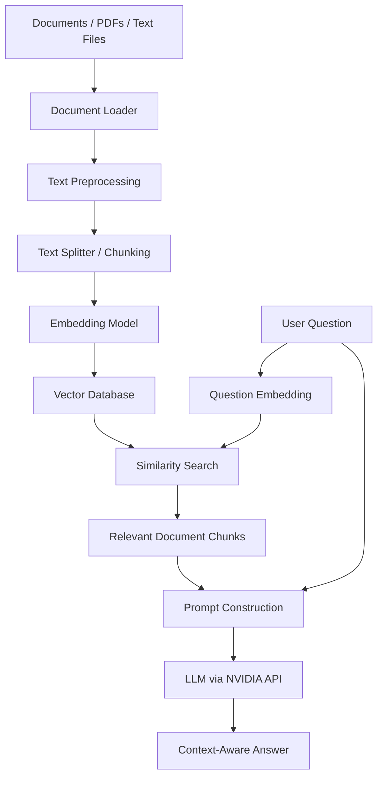

# 🚀 RAG GenAI — Retrieval-Augmented Generation with LangChain


## 📌 Overview

**RAG GenAI** is a Python-based project focused on learning and implementing Retrieval-Augmented Generation (RAG) using Large Language Models (LLMs), LangChain, and embedding models.

Retrieval-Augmented Generation combines information retrieval with generative AI to produce context-aware responses based on relevant information retrieved from external documents or knowledge sources.

Instead of relying entirely on the knowledge learned during model training, a RAG system retrieves relevant information from a custom knowledge base and provides it as context to an LLM. This helps generate more relevant, informative, and document-grounded answers.

This repository explores the complete RAG workflow, from document loading and text preprocessing to embedding generation, vector similarity search, prompt construction, and LLM-powered answer generation.

The project is designed for hands-on learning, experimentation, and gradual development toward practical GenAI applications.

## 🎯 Project Objectives

- Understand the fundamentals and architecture of Retrieval-Augmented Generation.
- Learn how Large Language Models work with external knowledge sources.
- Implement document loading, text splitting, and preprocessing.
- Generate semantic embeddings using Hugging Face embedding models.
- Understand vector databases and similarity search.
- Build LLM-powered pipelines using modern LangChain APIs and LCEL.
- Integrate NVIDIA-hosted language models for response generation.
- Explore prompt engineering, retrieval strategies, and contextual question answering.
- Develop a foundation for advanced applications such as document chatbots, PDF question-answering systems, and knowledge assistants.

## 🧠 What Is RAG?

Retrieval-Augmented Generation is an approach that connects an information retrieval system with a generative language model.

A traditional LLM generates responses primarily from the knowledge encoded in its model parameters and the context supplied in the prompt. A RAG system first retrieves relevant information from an external knowledge base and then uses that information to generate a response.

### 🔄 RAG Architecture



### ⚙️ How the RAG Pipeline Works

1. **Document ingestion:** Load information from supported sources such as PDFs, text files, or other document formats.
2. **Text preprocessing:** Clean and prepare the extracted content for downstream processing.
3. **Chunking:** Divide lengthy documents into smaller, manageable text segments.
4. **Embedding generation:** Convert text chunks into numerical vector representations that capture semantic meaning.
5. **Vector storage:** Store the embeddings and associated document content in a vector store.
6. **Question processing:** Convert the user's query into an embedding using a compatible embedding model.
7. **Retrieval:** Search the vector store for chunks that are semantically similar to the query.
8. **Context construction:** Combine the retrieved information with the original question in a structured prompt.
9. **Answer generation:** Send the prompt to the language model to generate a response grounded in the retrieved context.
10. **Response delivery:** Return the generated answer to the user, optionally including source references.

## 🛠️ Technology Stack

| Technology | Purpose |
|---|---|
| Python | Core programming language |
| LangChain | Building LLM and retrieval pipelines |
| LangChain Expression Language (LCEL) | Composing modular processing chains |
| NVIDIA API | Accessing hosted language models |
| Hugging Face | Accessing embedding models |
| Sentence Transformers | Generating semantic text embeddings when using compatible models |
| Vector Database | Storing embeddings and retrieving relevant chunks |
| Jupyter Notebook / Google Colab | Experimentation and development |
| python-dotenv | Managing environment variables |
| Git & GitHub | Version control and project documentation |

*The exact vector database, embedding model, and document loaders depend on the components implemented in the repository.*

## ✨ Key Concepts Covered

### 1. Document Loading
- Loading text and supported document formats.
- Extracting content from external knowledge sources.
- Preparing documents for downstream processing.

### 2. Text Splitting and Chunking
- Understanding why large documents are divided into chunks.
- Configuring chunk size and chunk overlap.
- Studying the effect of chunking on retrieval quality.
- Preserving useful document metadata.

### 3. Text Embeddings
- Understanding semantic representations of text.
- Generating embeddings with Hugging Face models.
- Comparing semantic similarity between queries and documents.
- Understanding embedding dimensions and model compatibility.

### 4. Vector Stores and Retrieval
- Storing document embeddings.
- Performing semantic similarity searches.
- Understanding top-k retrieval.
- Exploring metadata filtering and retrieval quality.
- Investigating vector-store options such as FAISS and Chroma.

### 5. LangChain and LCEL
- Building chains with `ChatPromptTemplate`.
- Connecting prompts, models, and output parsers.
- Using the pipe operator (`|`) to compose components.
- Working with `RunnablePassthrough`, `RunnableParallel`, and `RunnableLambda`.
- Developing reusable and modular LLM pipelines.

### 6. LLM Integration
- Connecting to NVIDIA-hosted language models.
- Constructing context-aware prompts.
- Controlling response formats and generation behavior.
- Handling API errors and environment configuration.

### 7. Retrieval-Augmented Question Answering
- Retrieving relevant information for a user query.
- Combining retrieved context with the original question.
- Generating answers using an LLM.
- Reducing unsupported answers through context-grounded prompting.
- Exploring source attribution and retrieval evaluation.

## 📂 Suggested Project Structure

```text
RAG-GenAI/
│
├── notebooks/
│   ├── 01_rag_fundamentals.ipynb
│   ├── 02_document_loading.ipynb
│   ├── 03_text_splitting.ipynb
│   ├── 04_embeddings.ipynb
│   ├── 05_vector_stores.ipynb
│   └── 06_rag_pipeline.ipynb
│
├── data/
│   ├── documents/
│   └── README.md
│
├── src/
│   ├── document_loader.py
│   ├── text_splitter.py
│   ├── embeddings.py
│   ├── vector_store.py
│   └── rag_pipeline.py
│
├── tests/
│   └── test_rag_pipeline.py
│
├── .env.example
├── .gitignore
├── requirements.txt
└── README.md
```

This is a suggested structure, not a claim that every file or module already exists in the repository.

## 🚀 Getting Started

### Prerequisites

Before running the project, make sure you have:

- Python 3.10 or a compatible version required by your dependencies.
- Basic knowledge of Python.
- A working understanding of LLMs and prompt engineering.
- Access to an NVIDIA API key if using NVIDIA-hosted models.
- Internet access for downloading required models and packages.

### Step 1: Clone the Repository

```bash
git clone https://github.com/YOUR_USERNAME/YOUR_REPOSITORY.git
cd YOUR_REPOSITORY
```

Replace the repository URL with your actual GitHub repository URL.

### Step 2: Create a Virtual Environment

**Windows:**

```powershell
python -m venv .venv
.venv\Scripts\Activate.ps1
```

**Linux / macOS:**

```bash
python3 -m venv .venv
source .venv/bin/activate
```

### Step 3: Install Dependencies

If a `requirements.txt` file is available:

```bash
pip install -r requirements.txt
```

Alternatively, install the packages required by your selected implementation:

```bash
pip install langchain langchain-core langchain-nvidia-ai-endpoints langchain-huggingface sentence-transformers python-dotenv faiss-cpu pypdf
```

Additional packages may be required depending on the selected vector store and document loaders.

### Step 4: Configure Environment Variables

Create a `.env` file in the project root:

```env
NVIDIA_API_KEY=your_nvidia_api_key_here
```

Use the environment variable name expected by your code. Never commit your real API key to GitHub.

Add the following entries to `.gitignore`:

```gitignore
.env
.venv/
__pycache__/
*.py[cod]
.ipynb_checkpoints/
```

### Step 5: Run the Project

Open the relevant notebook in Jupyter Notebook or Google Colab, or execute a Python script according to the repository's current structure.

```bash
python src/rag_pipeline.py
```

The command above applies only if the corresponding script exists and has been implemented.

## 🔍 Example Use Case

Imagine a user has a collection of technical PDFs containing information about Python, machine learning, or artificial intelligence.

A RAG-powered application can:

1. Extract text from the documents.
2. Divide the text into smaller chunks.
3. Generate embeddings for those chunks.
4. Store the embeddings in a vector database.
5. Retrieve relevant passages when a question is asked.
6. Pass the question and retrieved passages to an LLM.
7. Generate a response based on the available document context.

**Example question:**

> What is the difference between supervised and unsupervised learning according to the provided documents?

The system retrieves relevant passages and uses them to generate a context-aware answer instead of relying solely on the LLM's general knowledge.

## 📊 Benefits of RAG

- **External knowledge:** Connect language models to custom document collections.
- **Context-aware responses:** Supply relevant information at generation time.
- **Updatable knowledge:** Refresh the knowledge base without retraining the LLM.
- **Source traceability:** Support citations or document references when source metadata is retained and exposed.
- **Flexible architecture:** Combine different embedding models, retrievers, vector stores, and LLM providers.
- **Practical applications:** Build knowledge assistants, document search systems, and question-answering applications.

RAG can improve factual grounding, but it does not guarantee that every generated answer is accurate. Retrieval quality, source quality, prompt design, and model behavior all matter.

## 🧪 Experiments and Improvements

Potential experiments for extending the project include:

- Comparing different chunk sizes and overlap settings.
- Evaluating multiple Hugging Face embedding models.
- Comparing FAISS and Chroma vector stores.
- Testing similarity search against other retrieval strategies.
- Comparing different values of `top_k`.
- Implementing metadata filtering.
- Adding document citations to generated answers.
- Evaluating retrieval relevance and answer faithfulness.
- Exploring hybrid search and reranking.
- Investigating conversational memory and multi-turn question answering.
- Building a user interface using Streamlit or another suitable framework.

These are possible extensions and should be marked as completed only after implementation.

## 🔐 Security and Configuration

- Store API keys in environment variables rather than source code.
- Keep `.env` excluded from version control.
- Avoid uploading private documents or sensitive information to public repositories.
- Review the data handling policies of external model and embedding providers.
- Validate uploaded files and handle errors during document processing.
- Do not treat generated answers as guaranteed facts without appropriate verification.

## 🎓 Learning Outcomes

Through this project, the goal is to develop practical knowledge of:

- Retrieval-Augmented Generation architecture.
- Document processing and semantic search.
- Embedding models and vector representations.
- Vector databases and similarity-based retrieval.
- LangChain components and LCEL.
- LLM integration and prompt engineering.
- Context-grounded question answering.
- Designing modular and extensible GenAI applications.

## 🗺️ Future Roadmap

- [ ] Complete the basic RAG pipeline.
- [ ] Add support for PDF document ingestion.
- [ ] Implement text chunking and metadata preservation.
- [ ] Integrate Hugging Face embeddings.
- [ ] Implement persistent vector storage.
- [ ] Connect an NVIDIA-hosted LLM.
- [ ] Build a complete document question-answering pipeline.
- [ ] Add source references to generated responses.
- [ ] Explore advanced retrieval and reranking techniques.
- [ ] Implement RAG evaluation and error analysis.
- [ ] Build a user-friendly interface.
- [ ] Explore advanced RAG architectures and agentic workflows.

Update the checklist as the project progresses.

## 🤝 Contributing

Contributions, suggestions, bug reports, and improvements are welcome.

1. Fork the repository.
2. Create a new branch for your changes.
3. Implement and test your changes.
4. Submit a pull request with a clear description.

## 📚 Learning Resources

- [LangChain Documentation](https://python.langchain.com/docs/introduction/)
- [Hugging Face Documentation](https://huggingface.co/docs)
- [NVIDIA API Documentation](https://docs.api.nvidia.com/)
- [FAISS Documentation](https://faiss.ai/)
- [Chroma Documentation](https://docs.trychroma.com/)
- [Sentence Transformers Documentation](https://sbert.net/)

## 👨‍💻 Author

**Md Faisal Sheikh**

MCA Student | Python Developer | Machine Learning & Generative AI Enthusiast

Interested in exploring Large Language Models, Retrieval-Augmented Generation, NLP, deep learning, and practical AI applications.

- GitHub: [@faisu6339-glitch](https://github.com/faisu6339-glitch)

## ⭐ Support

If you find this repository useful for learning RAG, LangChain, and Generative AI, consider giving it a star ⭐ and sharing suggestions for improvement.

---

**Built for learning, experimentation, and the practical exploration of Retrieval-Augmented Generation and Generative AI.**
